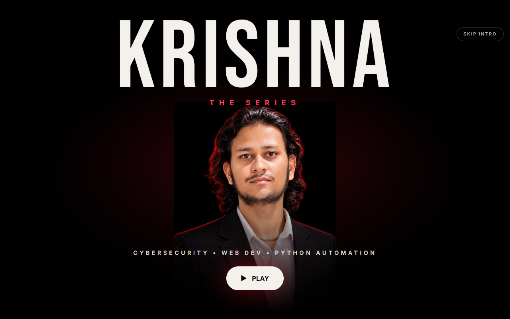

  

<h1 align="center">🎬 A KRISHNA ORIGINAL — Cinematic Developer Portfolio</h1>

  <b>An immersive Netflix/OTT-style portfolio experience with Star Wars 3D volumetric lighting, Marvel character rails, and 19 Disney animation principles.</b>

  
  
  

---

## 🎥 Live Preview

🔗 **[https://krishna-portfolio-sigma-one.vercel.app](https://krishna-portfolio-sigma-one.vercel.app)**

---

## ✨ What Makes This Portfolio Different

<table>
<tr>
<td width="50%">

### 🎬 OTT / Netflix Experience
- **Cold Open**: "A KRISHNA ORIGINAL" cinematic intro with sound cue
- **Who's Watching?**: 3-profile selector (Recruiter / Hacker / Casual)
- **Seasons & Episodes**: Journey mapped into OTT series format
- **Top Picks & Originals**: Interactive project showcase rail
- **Screenplay Resume Viewer**: Built-in PDF viewer with download

</td>
<td width="50%">

### ⚔️ Star Wars 3D FX & Marvel Rails
- **3D Volumetric Lighting**: Dual lightsaber rim glow (red + cyan)
- **Dynamic 3D Tilt**: Real-time directional shadow casting on hover
- **Marvel Character Rail**: Spider-Man, Iron Man, Thor, Black Panther, Captain America, Deadpool, Doctor Strange — animated hero tiles
- **Dual-Layer Cursor**: Instant plasma core + lagging follow-through halo

</td>
</tr>
</table>

### 🎭 19 Disney & UX Animation Principles Applied

| Principle | Implementation |
|:----------|:--------------|
| Origin Awareness | Shockwave erupts from exact click/tap coordinates |
| Squash & Stretch | Tactile spring physics on buttons and cards |
| Rubber Banding | Pull-past elastic bounce on scroll limits |
| Slow In / Slow Out | Smooth Lenis scroll with natural easing |
| Follow-Through | Cursor halo trails behind the pointer |
| Anticipation | Micro wind-up before card transitions |
| Staggering | Elements cascade in sequence, not unison |
| Arcs | Motion follows natural bezier arc paths |
| Doherty Threshold | All feedback under 400ms |
| Timing | UI animations capped at 300ms |
| + 9 more... | Exaggeration, Von Restorff, Fitts's Law, Hick's Law, Secondary Action, Solid Drawing, Interruptible Motion, Frequency of Use, Peak-End Rule |

---

## 🛠️ Tech Stack

| Layer | Technologies |
|:------|:-------------|
| **Framework** | React 18, TypeScript, Vite 6 |
| **Styling** | Tailwind CSS v4, Custom 3D CSS Transforms |
| **Animation** | Framer Motion 11, Lenis Smooth Scroll |
| **Lighting FX** | Volumetric Saber Shaders, Dynamic Shadow Casting |
| **Deployment** | Vercel (Edge Network) |

---

## 📸 Screenshots

  
   <i>Hero section with 3D tilt parallax and Star Wars volumetric lighting</i>

  
   <i>Marvel animated character episode rail with 3D hover zoom</i>

  
   <i>Netflix Originals-style project showcase</i>

---

## 💰 Want This Portfolio? Get the Source Code

This is a **premium, custom-built portfolio**. The source code is private.

If you want:
- 🎯 **This exact portfolio** customized with your details
- 🎨 **A custom cinematic portfolio** built from scratch
- 💼 **Source code license** for personal/commercial use

### 📬 Contact Me:

| Channel | Link |
|:--------|:-----|
| **Email** | [n1nj4cod3@proton.me](mailto:n1nj4cod3@proton.me) |
| **GitHub** | [@kr1shn4Sec](https://github.com/kr1shn4Sec) |

---

  <b>Built by <a href="https://github.com/kr1shn4Sec">Krishna Goyal</a> — Developer & Cybersecurity Specialist</b>
   
  <i>B.Tech CSE, ITM Gwalior (RGPV) • C3SA • CPTA V2 • GDG On Campus Lead</i>

